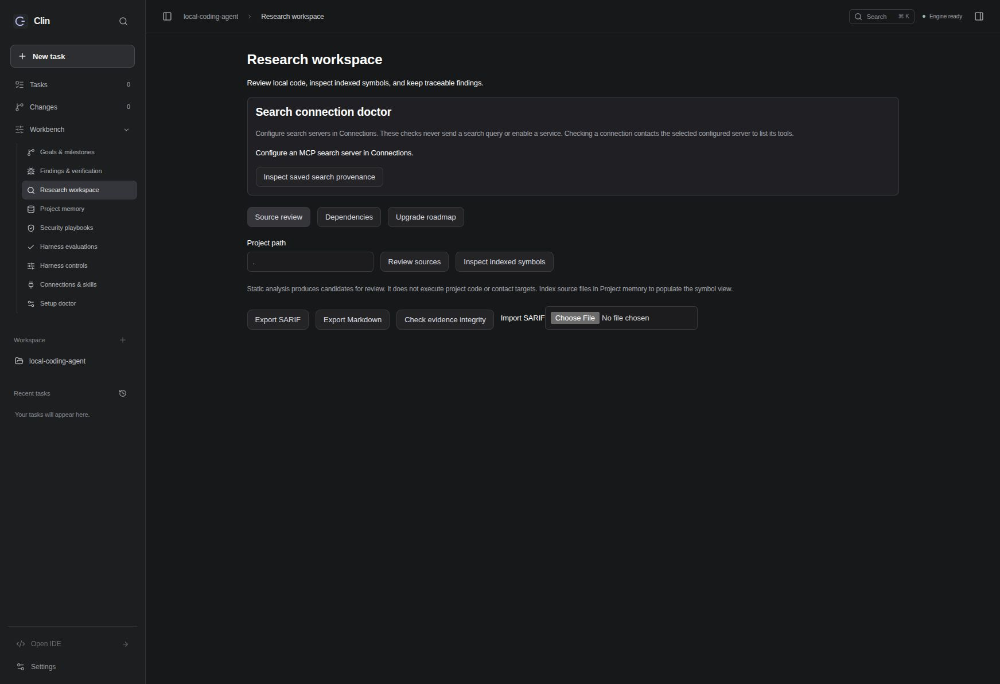

# Clin: fifty-item implementation and verification

This delivery changes execution boundaries, context retrieval, local security evidence, diagnostics, and release gates. It does not claim all fifty acceptance outcomes are independently verified or that Clin is commercially release-ready. The machine-readable status distinguishes 37 locally implemented contracts from 13 partial or externally unverified outcomes.

See [exact acceptance specification](../../roadmap/clin-50-spec.json) and [all fifty statuses](../../roadmap/clin-50-status.json). Each item points to focused regression files and a subsystem report below.

The final integration adds host-enforced parallel write scopes, persistent no-op/compaction guards, complete planned tasks, bounded checkpoint handoffs, admitted request telemetry (including summaries/retries and cancellation), permitted tool discovery, strict controlled finding verification, and upstream evidence-generation invalidation. Unknown mutation completion is never automatically replayed.

## Subsystem evidence

- [Execution and goals](task-1-coordinator-report.md)
- [Local security analysis and proof](task-2-report.md)
- [Context and memory](task-3-report.md)
- [Runtime bounds and verification](task-4-report.md)
- [UI and bounded research](task-5-report.md)
- [Evaluation and release gates](task-6-report.md)

## Independent review and fixes

A read-only integration reviewer found discarded model-profile tool preferences and a structured scanner capture truncated by generic process limits. Both have runtime regression coverage. Scanner-specific capture now archives exact bounded stdout/stderr bytes before JSON parsing, rejects over-limit/invalid results, and returns recovery references. A final baseline parse-error case now preserves observed scanner errors as partial/failed coverage, retains raw output and never presents an empty result as a complete scan.

A routing regression also showed that expanded scan data could crowd the evidence ID out of a bounded prompt. Engagement output now puts its stable evidence handle first; originals stay archived. Catalog admission regressions required synthetic tests to declare tools they actually execute; tests retain their behavioral assertions.

## Scope and remaining work

Security work analyzes this authorized repository only. Python route/service/guard observations and strict evidence lineage are implemented; guard effectiveness and dynamic/cross-file authorization are not inferred. Fuzz execution is a bounded inert fixture, with project-linked cases remaining unexecuted proposals until separately isolated validation.

Native matrix/signature checks and held-out model gates are implemented. Windows/macOS runner results, target-model quality/latency/cost measurements, signing, legal/brand clearance, root project licensing, privacy/support review and independently approved release evidence are not supplied by local tests. The readiness screen correctly keeps these unverified. Do not advertise a commercially approved release.

## Browser verification

The built frontend served through the real local HTTP engine loads the context attribution inspector, shows an honest empty request selection, displays all fifty readiness outcomes and missing external gates, and renders the search doctor with an explicit unavailable-server state. No external search, model inference or settings changes were submitted.

## Final validation

- Final full Python suite: **1,649 passed, 3 skipped, 8 warnings** (32.66 seconds). Skips and existing deprecation/collection warnings remain explicit.
- Frontend: **31 tests passed**, TypeScript/Vite production build and oxlint passed.
- Native protocol/unit suites: **29 desktop + 47 IDE tests passed** on Linux; these do not constitute Windows/macOS execution.
- Real Python HTTP engine through manager/IDE clients: startup ordering/race and owner-exit explicit reconnect passed.
- PyInstaller engine build passed. Electron pack passed. Packaged-engine/install results are recorded below.
- Python compileall and `git diff --check` passed. Ruff and the optional Hatchling wheel backend were unavailable; no installation or wheel-success claim.

## Installed delivery verification

Implementation commit `19720a2996a7d5664188954376cab54c0630d66d` is pushed to the existing PR #22 and installed in both manager and IDE. The engine specification explicitly bundles the immutable release specification JSON; packaged smoke exercises the readiness endpoint rather than assuming source-only tests prove packaging.

The packaged engine passed authentication rejection/acceptance, summary status, all fifty readiness entries, context debugger, search doctor, held-out catalog, real local tokenizer asset loading, evidence/report routes and existing offline evaluation smoke. The actual installed Code OSS extension-host smoke passed native activation, command registration, workspace verification and authenticated shared-engine refresh.

Both installed apps were reopened. The authenticated workspace engine answers the new routes, both engine digests match installation metadata, and both Chromium helpers retain administrator ownership and mode 4755. A rollback snapshot exists at the installation's `updates/19720a2`. No environment files, credentials or unrelated primary-checkout source edits were changed. This is local Linux verification, not a Windows/macOS result or commercial release approval.
